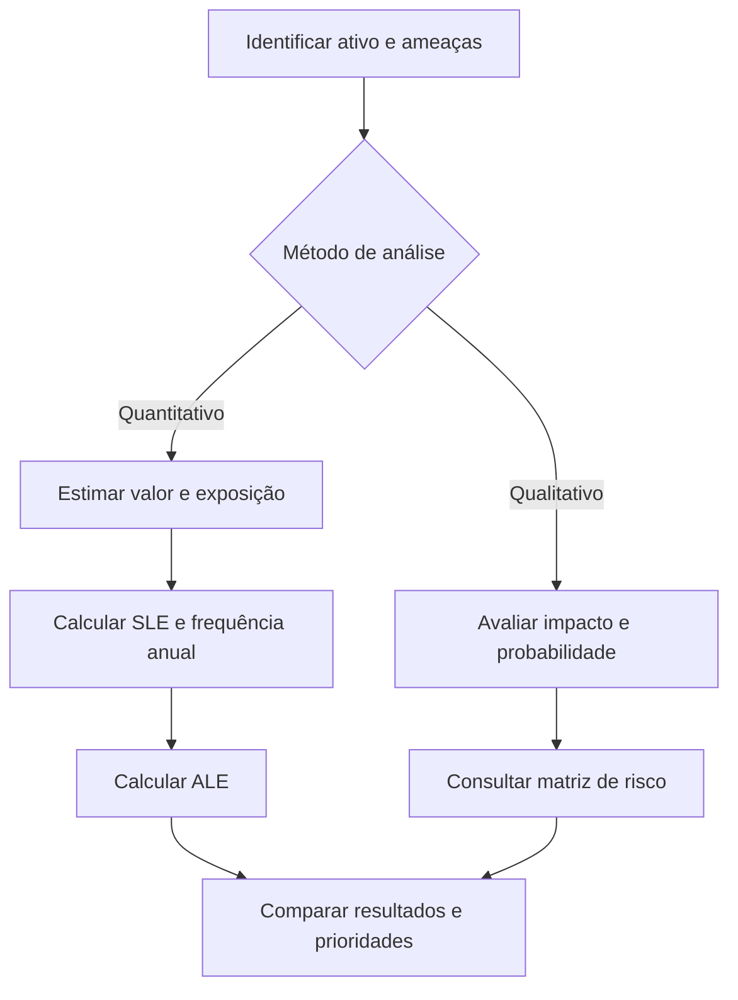

# Análise de riscos em segurança da informação

## Visão geral

Como decidir quais riscos precisam de mais atenção? Neste laboratório da **Cisco Networking Academy (NetAcad)**, o tema é analisado de duas formas: estimando possíveis perdas em dinheiro e classificando os riscos conforme o impacto e a probabilidade.

Os exercícios apresentam situações como falhas em equipamentos, roubo, ransomware e interrupções de serviços. O objetivo é entender como essas informações ajudam uma empresa a definir prioridades de segurança.

Esta documentação organiza os cenários do material e apresenta cálculos revisados. Os valores pertencem aos cenários educacionais propostos na atividade.

---

## Objetivos de aprendizagem

- Diferenciar análise quantitativa e qualitativa de riscos.
- Considerar custos de equipamentos, informações e reputação na avaliação de um ativo.
- Calcular a perda estimada por evento e por ano.
- Relacionar impacto e probabilidade para classificar riscos.
- Comparar estimativas para apoiar decisões de segurança.

---

## Métodos de análise

| Método | Como funciona | Para que ajuda |
|---|---|---|
| Quantitativo | Usa valores e estimativas de frequência para calcular perdas. | Comparar possíveis prejuízos financeiros. |
| Qualitativo | Combina categorias de impacto e probabilidade. | Organizar prioridades mesmo quando os custos são difíceis de estimar. |

Os dois métodos podem se complementar. Uma perda estimada em dinheiro não resume, sozinha, todos os efeitos de um incidente.

---

## Etapas da análise

1. Identificar o ativo e os custos considerados em seu valor.
2. Listar as ameaças apresentadas em cada cenário.
3. Estimar a parcela do valor que poderia ser perdida em um evento.
4. Converter a frequência dos eventos para uma base anual.
5. Calcular a perda por evento e a perda anual estimada.
6. Consultar a matriz para classificar os cenários qualitativos.
7. Comparar os resultados e revisar possíveis divergências.

---

---

## Como os cálculos funcionam

| Indicador | Cálculo | Interpretação |
|---|---|---|
| Valor do ativo | Soma dos custos considerados no cenário | Valor utilizado como base para estimar a perda. |
| EF | Perda estimada ÷ valor do ativo | Fração do valor perdida em um evento. |
| SLE | Valor do ativo × EF | Perda estimada por ocorrência. |
| ARO | 1 ÷ intervalo em anos | Frequência média anual de um evento. |
| ALE | SLE × ARO | Perda anual estimada. |

Se o intervalo estiver em meses, a ARO pode ser calculada como **12 ÷ intervalo em meses**. Um evento a cada cinco anos tem ARO de **0,2**; dois eventos por ano têm ARO de **2**. A ARO representa frequência, não uma porcentagem de probabilidade.

---

### Exemplo do servidor

O cenário inicial considera US$ 20.000 em hardware, software e configuração, US$ 40.000 na criação do site e US$ 75.000 de valor público, incluindo reputação. A base total é **US$ 135.000**.

| Situação | Cálculo | Resultado |
|---|---|---|
| Exposição para restauração de US$ 30.000 | 30.000 ÷ 135.000 | Aproximadamente 22,22% |
| Perda por DoS, com exposição de 20% | 135.000 × 0,20 | US$ 27.000 |
| Perda por falha de armazenamento, com exposição de 50% | 135.000 × 0,50 | US$ 67.500 |
| Perda por ransomware, com exposição de 100% | 135.000 × 1 | US$ 135.000 |
| Frequência de ransomware a cada 24 meses | 12 ÷ 24 | ARO de 0,5 |
| Frequência de falhas a cada 30 meses | 12 ÷ 30 | ARO de 0,4 |

Os percentuais são premissas do exercício. Ransomware não implica necessariamente perda total em qualquer situação real.

---

## Resultados quantitativos revisados

Os valores abaixo foram recalculados com base no enunciado. Valores monetários estão em dólares americanos. As somas de ALE seguem a simplificação adotada pelo exercício, sem avaliar sobreposição entre perdas.

---

### Notebooks

A empresa fictícia possui 65 notebooks, mas o exercício pede a análise de **um equipamento**, no valor de **US$ 1.200**.

| Ameaça | EF | SLE (US$) | Frequência | ARO | ALE (US$) |
|---|---|---:|---|---:|---:|
| Roubo | 100% | 1.200,00 | A cada 2 anos | 0,5 | 600,00 |
| Dano por queda | 60% | 720,00 | A cada 5 anos | 0,2 | 144,00 |
| Malware | 20% | 240,00 | 2 vezes por ano | 2 | 480,00 |
| **Total por notebook** | | | | | **1.224,00** |

---

### Rede de armazenamento

Valor do ativo: **US$ 250.000**.

| Ameaça | EF | SLE (US$) | Frequência | ARO | ALE (US$) |
|---|---|---:|---|---:|---:|
| Falha de disco | 5% | 12.500,00 | 2 vezes por ano | 2 | 25.000,00 |
| Interrupção de energia | 100% | 250.000,00 | A cada 8 anos | 0,125 | 31.250,00 |
| DoS/DDoS | 10% | 25.000,00 | A cada 2 anos | 0,5 | 12.500,00 |
| **Total** | | | | | **68.750,00** |

---

### Servidor de banco de dados

Valor do ativo: **US$ 20.000**, incluindo US$ 18.000 do servidor e US$ 2.000 de configuração e instalação.

| Ameaça | EF | SLE (US$) | Frequência | ARO | ALE (US$) |
|---|---|---:|---|---:|---:|
| Falha na unidade | 5% | 1.000,00 | A cada 18 meses | 12/18 | 666,67 |
| Interrupção de energia | 100% | 20.000,00 | A cada 5 anos | 0,2 | 4.000,00 |
| DoS/DDoS | 15% | 3.000,00 | A cada 4 anos | 0,25 | 750,00 |
| Roubo de informações | 40% | 8.000,00 | A cada 2 anos | 0,5 | 4.000,00 |
| Erros de configuração | 1% | 200,00 | Mensal | 12 | 2.400,00 |
| **Total** | | | | | **11.816,67** |

A fração 12/18 foi mantida durante o cálculo; o arredondamento foi aplicado apenas ao resultado monetário.

---

### Sistema de ponto de venda

Valor do ativo: **US$ 15.000**, incluindo aquisição, configuração e instalação.

| Ameaça | EF | SLE (US$) | Frequência | ARO | ALE (US$) |
|---|---|---:|---|---:|---:|
| Roubo de equipamentos | 100% | 15.000,00 | A cada 5 anos | 0,2 | 3.000,00 |
| Falha de equipamentos | 10% | 1.500,00 | 2 vezes por ano | 2 | 3.000,00 |
| Ransomware | 20% | 3.000,00 | A cada 10 anos | 0,1 | 300,00 |
| Violação de dados | 40% | 6.000,00 | A cada 5 anos | 0,2 | 1.200,00 |
| **Total** | | | | | **7.500,00** |

---

### Nuvem privada

Valor do ativo: **US$ 1.000.000**, somando US$ 500.000 da infraestrutura, US$ 50.000 de configuração e instalação e US$ 450.000 de desenvolvimento de aplicações.

| Ameaça | EF | SLE (US$) | Frequência | ARO | ALE (US$) |
|---|---|---:|---|---:|---:|
| Interrupção de energia | 50% | 500.000,00 | A cada 5 anos | 0,2 | 100.000,00 |
| DoS/DDoS | 40% | 400.000,00 | A cada 2 anos | 0,5 | 200.000,00 |
| Violação de dados | 40% | 400.000,00 | A cada 10 anos | 0,1 | 40.000,00 |
| Inundação | 100% | 1.000.000,00 | A cada 20 anos | 0,05 | 50.000,00 |
| **Total** | | | | | **390.000,00** |

Uma ALE de US$ 390.000 não significa que esse prejuízo ocorrerá todo ano. É uma estimativa média baseada nos valores e frequências adotados.

---

## Análise qualitativa

A classificação depende do cruzamento entre impacto e probabilidade. Aplicando literalmente a coluna de impacto informada em cada cenário à matriz do material:

| Evento | Impacto | Probabilidade | Classificação pela matriz |
|---|---|---|---|
| Falha de disco do servidor Web | Alto | Possível | Moderado |
| Ataque DoS/DDoS | Alto | Provável | Principal |
| Incêndio na sala do servidor | Alto | Raro | Moderado |
| Roubo de dados de cartão | Alto | Improvável | Moderado |
| Tornado | Baixo | Raro | Secundário |

Os nomes das categorias seguem o material didático. Eles não devem ser tratados como uma classificação universal para qualquer empresa.

---

## Conferência e ajustes

| Item conferido | Divergência identificada | Tratamento nesta documentação |
|---|---|---|
| ARO para eventos a cada 5 anos | Algumas células mostram 2, embora a frequência corresponda a 0,2. | ARO corrigida para 0,2 em queda de notebook, roubo no ponto de venda e violação de dados no ponto de venda. |
| Falha a cada 18 meses | A resposta apresenta ARO 0,66 e ALE de US$ 666. | Usada a fração 12/18, com ALE de US$ 666,67 e total de US$ 11.816,67. |
| Matriz qualitativa | As respostas de falha de disco e roubo de cartão indicam “Principal”, mas as células para impacto alto e as probabilidades descritas indicam “Moderado”. | Mantido o resultado obtido pelo cruzamento literal da matriz. |
| Fator de exposição da restauração | O material arredonda 30.000 ÷ 135.000 para 22%. | Registrado aproximadamente 22,22%. |

A conferência dos resultados foi feita a partir das fórmulas e da matriz apresentadas no material.

---

## Conhecimentos trabalhados

- Avaliar o impacto de um incidente além do custo de compra de um equipamento.
- Converter intervalos de meses ou anos em frequência anual.
- Diferenciar perda por ocorrência de perda média anual.
- Conferir se uma resposta é compatível com a fórmula e com a matriz utilizada.
- Relacionar falhas, indisponibilidade e exposição de informações às prioridades de cibersegurança.

Em Suporte de TI, registros de incidentes podem ajudar a estimar a frequência de falhas. Em Cibersegurança, essas informações apoiam a análise de impacto e a priorização de medidas de proteção.

---

## Entendendo os termos técnicos

| Termo | O que significa? |
|---|---|
| Ativo | Algo que tem valor para a empresa, como equipamentos, informações ou serviços. |
| Ameaça | Algo que pode causar danos, como roubo, incêndio ou um ataque. |
| Vulnerabilidade | Uma fragilidade que pode facilitar um incidente. |
| EF | Parcela do valor de um ativo que se estima perder em uma ocorrência. |
| SLE | Valor estimado da perda causada por um único evento. |
| ARO | Quantidade média de ocorrências de um evento por ano. |
| ALE | Valor médio de perda anual estimado para uma ameaça. |
| DoS/DDoS | Ataque que tenta deixar um serviço indisponível; no DDoS, o ataque vem de várias origens. |

Ransomware é um tipo de software malicioso que pode bloquear dados ou sistemas e exigir pagamento.

---

## Onde esse conhecimento pode ser aplicado?

**Cenário fictício: prioridades de uma pequena loja**

**Situação:** uma loja depende do sistema de vendas para atender seus clientes. A gestão precisa avaliar riscos como falhas nos equipamentos, interrupções de energia e roubo de informações.

**Aplicação:** a equipe pode estimar o prejuízo de cada evento e sua frequência, além de avaliar efeitos no atendimento e na confiança dos clientes. Isso ajuda a discutir quais medidas de proteção merecem atenção primeiro.

**Benefício esperado e relação com o laboratório:** tomar decisões com critérios mais claros, usando os mesmos conceitos de impacto, probabilidade e perdas estimadas estudados na atividade. O exemplo apresenta uma aplicação fictícia dos conceitos estudados.
